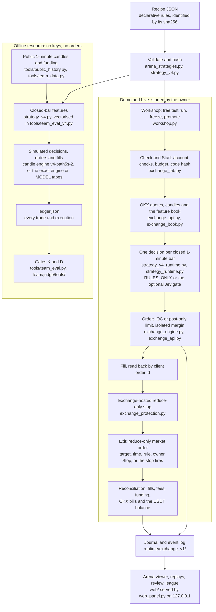
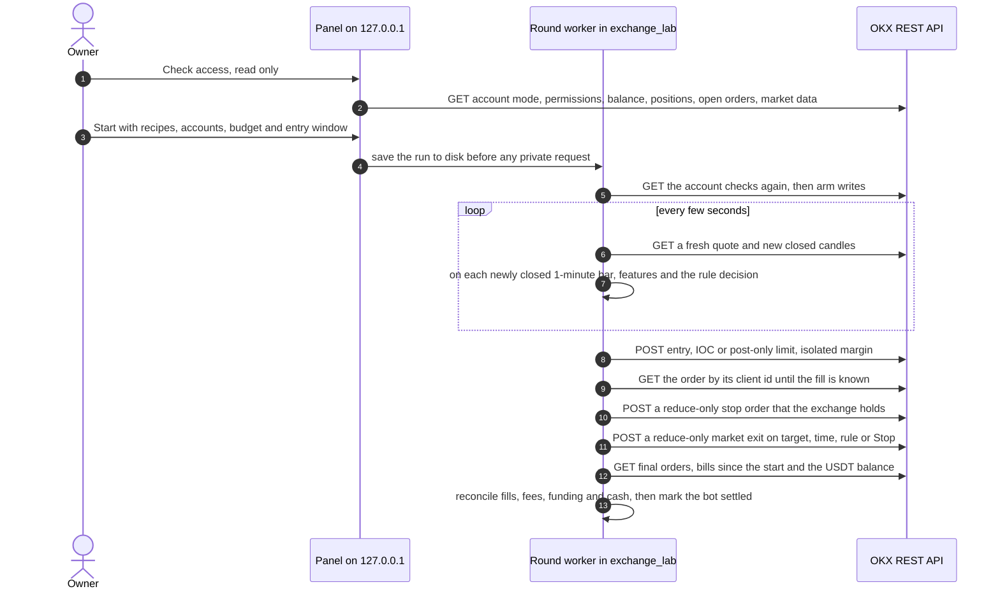

# Architecture

The repository is one Python package, `trading_lab/`, used by three kinds of programs:

- **command-line tools** in `tools/` and `team/judge/tools/`: the data downloader, the official evaluator, the strategy workshop, UI previews and exports;
- **a local web panel** (`web_panel.py`) that serves the pages in `web/` and runs the arena, the workshop and the owner's Demo and Live rounds;
- **offline tests** in `tests/`, with fake exchanges and fake model transports.

The core uses only the Python standard library. numpy is needed for the vectorised evaluator and the Judge's tools; Pillow is optional. The browser code is plain HTML, CSS and JavaScript with no build step. All state lives in files under `runtime/` (JSON, JSONL and SQLite); there is no database server and no cloud component. The panel was built for one owner on one Windows PC.

This document follows a strategy recipe from the JSON file to a reconciled trade, then describes the safety rails, the arena viewer and the evaluator. [QUICKSTART.md](QUICKSTART.md) shows how to run things; [METHODOLOGY.md](METHODOLOGY.md) explains the gates; [RECIPE_SPEC.md](RECIPE_SPEC.md) describes the recipe format.

## Contents

1. [The big picture](#1-the-big-picture)
2. [Recipes and the three engines](#2-recipes-and-the-three-engines)
3. [Modules and their jobs](#3-modules-and-their-jobs)
4. [From recipe to reconciled trade](#4-from-recipe-to-reconciled-trade)
5. [Safety rails](#5-safety-rails)
6. [The arena viewer](#6-the-arena-viewer)
7. [The evaluator and the gates](#7-the-evaluator-and-the-gates)
8. [Where state lives](#8-where-state-lives)
9. [Limits of this design](#9-limits-of-this-design)

## 1. The big picture

The same recipe can go two ways: offline into the evaluator, which replays it on public history and computes the gates, or, after the owner freezes and promotes it, into a Demo or Live round on OKX.

## 2. Recipes and the three engines

A recipe is a JSON file with declarative rules: no code is ever executed from it, and its free-text fields are stored as evidence only. Every validated recipe gets a `recipe_sha256` over its canonical JSON, so any change, even to a description, makes a new recipe. Four format versions exist, because the contract grew during the project; the code calls them schemas (`strategy_schema_version`):

| Format | Used for | What it can express |
|---|---|---|
| 1 | the first author recipes (V1) | entry and exit conditions on seven snapshot features (returns, SMA gap, RSI, range position, volume ratio, spread), BTC only |
| 2 | later author drafts and Demo checks (V2) | setup, confirm and invalidate steps over several bars, long, short or both, adds, partial reduces, a cost checkpoint, an open-ended hold, BTC only |
| 3 | one human-authored pilot (G1) | a fixed pattern recognizer, paper only |
| 4 | the final contract, used by both final candidates | closed-bar features on 1-minute to 1-day bars for BTC, ETH and SOL, taker or post-only entries, stop, target, maximum hold up to 24 hours, funding, premium and basis features |

`arena_strategies.validate_strategy` dispatches on the format; `strategy_v4.validate_payload` handles format 4. The details of format 4 are in [RECIPE_SPEC.md](RECIPE_SPEC.md).

The same rules run in three engines:

1. **The candle engine** of the official evaluator (`tools/team_eval_v4.py`, numpy). It turns each 1-minute candle into a 5-second price path and simulates format-4 recipes over years of history in minutes.
2. **The exact engine** (`trading_lab/arena_engine.py`, driven by `strategy_training.run_trial`). It runs on 5-second quote tapes: synthetic ones in the workshop, MODEL tapes built from public candles by `tools/okx_tape_model.py` in the evaluator for formats 1 and 2, and live public quotes in PAPER seasons.
3. **The exchange executor** (`trading_lab/exchange_lab.py` and its helpers). It runs the rules against OKX Demo or Live with real orders.

Conformance tests keep them in line. For a taker recipe the candle engine reproduced the exact engine trade for trade (610 of 610 trades over 90 seasons in 2025Q1), and `tools/v4_conformance.py` runs format-4 recipes through both.

## 3. Modules and their jobs

### Strategy contract and decisions (`trading_lab/`)

| Module | Job |
|---|---|
| `arena_strategies.py` | Validates and hashes recipes of every format; holds the built-in sample recipes. |
| `strategy_contract.py` | The authoring contract handed to strategy authors. |
| `strategy_v2.py`, `strategy_runtime.py` | The format-2 kernel (episodes of setup, confirm and invalidate) and its bridge to the engines: one advance per completed bar, pure rechecks. |
| `strategy_v4.py` | Format 4: validation, feature definitions on completed bars, decisions. A feature without enough history is UNKNOWN, and UNKNOWN anywhere in an entry rule forbids the entry. |
| `strategy_v4_book.py`, `strategy_v4_feed.py`, `strategy_v4_runtime.py` | The feature book (closed bars to feature values, built incrementally), its live warm-up from public history, and format 4 inside the exact engines: decision timing, entry recheck, resting post-only orders. |
| `match_protocol.py` | Immutable match rules: seven entry windows from 300 seconds to 24 hours, then a drain phase until every bot is flat. |
| `risk.py` | Small deterministic checks used by the offline demo. |

### Simulation and evaluation

| Module | Job |
|---|---|
| `trading_lab/arena_engine.py` | Virtual execution and accounting: 5 bps fee and 2 bps slippage per execution, spread, funding. Never imports an executor or keys. |
| `trading_lab/strategy_training.py` | `run_trial`: reproducible runs on synthetic or recorded tapes, with the hash of the engine code. |
| `tools/public_history.py` | Downloads public OKX 1-minute candles, index and mark candles and funding up to a cutoff; resumable, paced, GET only. |
| `tools/team_data.py` | The market-data store: catalogue, hashes and a range loader. |
| `tools/okx_tape_model.py` | Builds 5-second MODEL quote tapes from candles. |
| `tools/team_eval.py`, `tools/team_eval_v4.py` | The official evaluator: recipe and store to ledger and gates (section 7). |
| `tools/strategy_workshop.py` | The free author kit: validate, lint, explain, synthetic test, compare. |
| `tools/arena_eval.py`, `tools/author_backtest.py`, `tools/field_ff.py`, `tools/v4_conformance.py` | A secondary evaluation stand, a fast unofficial screening backtest, a "who finishes first" field calculator, and the conformance check between engines. |
| `team/judge/tools/` | The Judge's independent tools: `gate_k_long.py` (long-horizon timing test), `gate_d_first_n.py` (gate D count of the first N trades), `live_round_facts.py`, `j2_outcomes.py`. |

### Exchange execution (OKX)

| Module | Job |
|---|---|
| `exchange_accounts.py` | Key profiles read only from local files: one Demo profile and Live subaccount profiles. |
| `exchange_api.py` | The executor's REST client: signed requests to fixed lists of endpoints, write guards, account preflight, the market feed. |
| `exchange_lab.py` | The round lifecycle: Check, Start, Stop, Resume, the step loop, recovery and settlement. The largest module (about 2,800 lines). |
| `exchange_engine.py` | Pure rules and accounting for exchange rounds: order bodies, fill records, settlement. No transport. |
| `exchange_execution.py` | Execution policies: RULES_ONLY (the recipe decides; the model request is only recorded) and the paid shared Jev gate. |
| `exchange_protection.py` | The exchange-hosted stop: place it, resize it, verify it, recover it. |
| `exchange_book.py` | The format-4 feature book for Demo and Live; fills holes in the minute series from public history. |
| `exchange_clock.py` | OKX server time plus monotonic process time; the computer's clock is used for diagnostics only. |
| `exchange_diagnostics.py` | Fixed failure codes; exception bodies and keys are never written out. |
| `live_denylist.py`, `live_leverage.py` | Recipes refused for Live, and the per-recipe leverage limits (every other recipe trades at 1×). |
| `okx_readonly.py`, `public_market.py` | GET-only diagnostics and a single public ticker read. |
| `one_trade.py`, `position_cycle.py`, `cycle_*.py` | The project's first execution test: a one-shot or monitored BTC bot behind the `/live` page. |
| `demo_execution.py`, `cycle_probe.py`, `demo_v8_review.py` | Fixed Demo-only checks of the execution mechanics. |

### The LLM gate ("Jev")

The project set out to test a paid third-party decision model, `typesafe/jev-1.13`, reached through OpenRouter. In the code it is called Jev.

| Module | Job |
|---|---|
| `jev.py` | Client for the paid decision endpoint, with a SQLite budget ledger. |
| `arena_jev.py` | The shared gate: the model can only approve or veto entries and adds; numbers, risk and exits stay in code. An error, a timeout or an answer older than 8 seconds means hold. |
| `jev_review.py`, `shadow_jev.py`, `owner_shadow.py`, `gate_shadow.py` | One-off reviews and offline SHADOW analysis of recorded requests. A SHADOW label cannot execute, veto or delay an order. |

### Panel, arena and evidence

| Module | Job |
|---|---|
| `web_panel.py` | The loopback HTTP server: pages, JSON state, protected POST actions. |
| `viewer_cache.py` | Short-lived shared copies of the state, so many open tabs cost one read. |
| `arena.py`, `arena_market.py` | PAPER seasons: simulated trades on public OKX quotes, no keys. |
| `workshop.py`, `workshop_tools.py`, `workshop_diagnostics.py`, `staged_qualification.py` | Recipe versions, free test runs, freeze and promote, lint and explain. |
| `league.py` | The ongoing local league: cohorts of rounds, the Cash benchmark, eligibility. |
| `match_journal.py`, `event_replay.py` | Append-only step evidence with checkpoints, and causal replay packets that never show a later fact in an earlier frame. |
| `battle_review.py`, `battle_export.py`, `battle_debrief.py`, `review_diagnostics.py`, `execution_sensitivity.py` | Per-author evidence bundles, a credential-free ZIP of a round, an HTML debrief, and cost overlays on recorded fills. |
| `public_site.py`, `spectator_export.py` | Local static exports of finished rounds. Nothing is uploaded. |
| `ops_service.py`, `ops_storage.py`, `ops_policy.py`, `public_recorder.py` | Public market recording, health checks, segmented logs and backups. |
| `causal_htf.py`, `htf_feed.py`, `ikigai_g1.py`, `ikigai_g1_reference.py`, `g1_public_evidence.py`, `news_features.py` | Offline research pilots: higher-timeframe context, the human-authored G1 pattern, news features. |

### Deployment and launchers

- `deployment/server/run_server.py` with three PowerShell scripts installs and runs the panel on a dedicated Windows PC (`check`, `serve`). `tools/build_server_bundle.py` builds a secret-free application bundle for that PC, and `tools/server_transfer.py` moves the panel's state from one computer to another.
- The root `*.cmd` files are the owner's Windows shortcuts, for example: start the panel, restart it, transfer state, run the notifier, or run a five-hour PAPER observation. The double-click launcher for the real-money one-trade bot is deliberately left out of this repository.
- `tools/arena_notifier.py` sends round events to Telegram; it only reads the local panel.

## 4. From recipe to reconciled trade

This is the path of one trade in a Demo or Live round. The offline evaluator models the same steps; the differences are noted at the end.

1. **Recipe.** Only recipes from the arena catalogue can start a Live round: the built-in samples and the recipes the owner froze and promoted in the workshop. Freezing needs one complete free test run of that exact version on the current engine code; profit is not a condition. The Start re-checks the sha256 and refuses recipes on the Live deny list. Format-4 recipes run only in RULES_ONLY mode.
2. **Features.** Every value comes from completed bars. A bar becomes visible 5 seconds after it closes. One missing minute is filled flat at the previous close; a longer hole makes every feature that reaches over it UNKNOWN until `exchange_book.py` has read the missing minutes from public history. Index, mark and funding inputs are read with a delay, as they would be seen live.
3. **Decision.** One rule decision per newly visible closed 1-minute bar. In RULES_ONLY mode the recipe decides alone and the model request is only recorded for later analysis. In shared_jev mode the paid model may veto an entry or an add. Before an entry order is written, the account checks must be at most 10 seconds older than a fresh quote, the quote at most 10 seconds old, and the entry rule is checked again on it.
4. **Order.** A taker entry is an IOC limit at most 2 bps through the best price. A post-only entry rests at the recipe's limit until it fills or its timeout ends, and it is never sent if it would cross the book. Orders use isolated margin, net position mode and a client order id; the size is rounded down to the exchange lot, and below one lot the bot holds. The entry notional is capped at 30% of the bot's budget times its leverage.
5. **Fill.** The worker reads each order back by its client id. A partial fill is owned and managed; the unfilled rest of a post-only order is cancelled at the timeout.
6. **Protection.** After every fill (entry, add or partial reduce) the worker places or resizes a reduce-only stop order held by the exchange: a stop-market triggered by the last price, cancelled by OKX when the position closes. It reads the stop back to verify it. If protection cannot be confirmed, the bot goes to recovery.
7. **Exit.** Target, maximum hold, a recipe exit, a cost checkpoint, a partial reduce or the owner's Stop sends a reduce-only market order. After the entry window ends, no new entries or adds are allowed, but open positions keep their own exits until they are flat (the drain phase). Stop, risk limits and recovery take priority over the recipe.
8. **Reconciliation.** When the bot is flat and has no open orders, the worker reads the final order results, the OKX bills since the bot began and the USDT balance. It stores the raw bills and balance in the journal with a hash, then checks that fills, fees, funding and the change in cash agree (`accounting_confirmed`). A foreign order or position on the account, or a mismatch, puts the bot into manual review; the code never closes a position it does not own.
9. **Journal.** Every step is appended to `runtime/exchange_v1/<run>.events.jsonl`, with periodic checkpoints in `<run>.json`. Replays, reviews and exports are built from these files.

The offline evaluator replaces steps 3 to 8 with a model: each 1-minute candle becomes a 5-second path (open-low-high-close or open-high-low-close) with a one-tick spread; taker executions pay 5 bps fee and 2 bps slippage; a post-only order fills only when the path goes through the limit by at least max(1 bps, 2 ticks), paying 2 bps fee and 2 bps for adverse selection; the stop is live from the fill and the target from the next minute, and if both could trigger in one minute the stop wins; funding is charged as recorded, or at a conservative rate where records are missing. The exact details are in [METHODOLOGY.md, section 3](METHODOLOGY.md#3-the-accounting-model-shared-by-all-gates).

## 5. Safety rails

These rails are in the code, not only in the documents.

**Nothing trades by default**
- Starting the panel only serves pages. Opening or refreshing a page never places an order, and the server does not resume old rounds on its own.
- `one_trade.py` refuses to run without `--check` (read-only) or `--live`.
- The exchange client starts with writes disarmed. Only a Start or Resume that has saved the run to disk and passed the account checks arms it.
- Tests and the UI previews use fake exchanges and fake model transports.

**The panel**
- The server listens on 127.0.0.1 only. A POST is accepted only with the panel's own Host, the same Origin and a random token generated at server start and injected into the served page.
- Request URLs and headers are not logged. Pages are sent with a strict Content-Security-Policy: scripts, styles and fonts only from the panel itself.

**Keys and accounts**
- No keys are in the repository. Demo and Live profiles read keys only from local files (`.env.okx.demo.local`, `.env.okx.arena-<name>.local`) and ignore environment variables; Demo and Live must use different files, and the `OKX_ENV` in the file must match the profile.
- The account check requires Trade permission, futures account mode and net position mode. For Live it also requires a dedicated subaccount (its uid differs from the main account's) and refuses a key that can withdraw.
- The executor only knows fixed lists of GET and POST endpoints. The POST list is orders, cancels, stop orders and leverage; there is no withdrawal or transfer endpoint.

**Orders and money**
- Entries are IOC or post-only limit orders with isolated margin; exits and stops are reduce-only. The client refuses more than 120 write requests per account in one worker run.
- Budget 25 to 500 USDT per bot and at most 1,000 USDT per round; entry windows from 300 seconds to 24 hours; one net position per bot.
- Leverage is 1× unless the recipe is listed in `live_leverage.py` and the owner chooses more, never above 10×.
- When the worker cannot resolve a failure, the round pauses. A Resume is close-only: it can only reconcile and close, with no new entry and no paid model call.
- A Start is refused if the exchange code on disk changed since the panel started, so a round always runs the code that was loaded and hashed.

**Paid calls**
- Every paid model path has a SQLite ledger with an attempt cap and a soft dollar cap. If the cost of a past call is unknown, no new paid call is made.

**Evidence**
- Event logs are append-only and recipe versions are immutable: a changed recipe is a new version with a new sha256.
- Replays, review bundles and static exports are built from the journals by allowlisted projections that leave out keys and raw account records.

## 6. The arena viewer

The arena is the page at `/arena` (`web/arena.html`, `arena.js`, `arena-coliseum.js` and their CSS, with the artwork in `web/assets/`). Its default view is read-only and made for spectators:

- Each strategy in the current or last round is a figure in a drawn colosseum: a human for a human author, a robot for an AI author. A participant called Cash never trades and serves as the benchmark.
- A figure stands inside the ring while the exchange confirms an open position and outside when the bot is flat. A partial close keeps it inside. If the position becomes unknown, the figure keeps its last known state and is labelled as unknown. A knock-out is shown only when the known equity is zero or below.
- The participant list shows each bot's result after exchange fees and funding, its state, side and size. The paid model's cost is shown separately, in USD.
- Recorded rounds can be replayed from their event logs (`event_replay.py`, `web/event-replay.js`). The animated image in the README is such a replay of a real round.
- The owner's controls open in a separate dialog (the "Керування" button); PAPER seasons and older tools sit in a collapsed block.

The other pages: `/workshop` (recipe versions, free test runs, the Demo check), `/review` (per-author evidence: decision funnel, ledger, timing), `/league` (cohorts of rounds and the Cash benchmark) and `/live` (the old one-bot page).

The pages poll JSON endpoints (`/api/exchange/state`, `/api/arena/state` and others) every few seconds. Polling requests are marked, so many open tabs share one short-lived copy of the state. All scripts, styles and fonts are local; the pages make no request outside the panel. The interface is in Ukrainian.

## 7. The evaluator and the gates

`tools/team_eval.py run` takes a recipe, a catalogued data store and a span:

1. It validates the recipe and checks that the store holds the recipe's instrument.
2. For format 4 it loads the minutes (with up to 90 days of warm-up) and the funding records, and runs the candle engine of `tools/team_eval_v4.py` as one continuous 100 USDT account with one position. For formats 1 and 2 it builds MODEL tapes for one-day windows, runs the exact engine in parallel worker processes and joins the windows into one account; if more than 5% of trades have to be dropped as overlapping, the verdict is NEEDS_SEQUENTIAL_RUN.
3. It writes `ledger.json` (every trade and execution, the hashes of the recipe, the evaluator, the engine code, the data files and the store catalogue), `gates.json` and `gates.md`, and appends a line to a run registry so that no attempt disappears.

Fixed rules inside the evaluator:

- In DEV mode it never reads data after 2026-10-02 18:31 UTC, the development cutoff. Later data can only be read with `--set sealed` or `--set forward`.
- Costs: 5 bps fee and 2 bps slippage per taker execution, a one-tick spread, real funding where recorded and a conservative charge where it is missing. Stress adds 5 bps of every execution's notional afterwards.
- A data gap or an engine error fails the gates; windows are never skipped.
- `--declared-n N` computes gate D on the first N closed trades only, exactly as the Judge's independent script `team/judge/tools/gate_d_first_n.py` does; both must agree on a hash of the trade prefix.
- `gates --ledger` recomputes the gates from a saved ledger, and `clone` compares two ledgers for entry overlap and daily PnL correlation.

The gates themselves:

- **Gate K** (historical, DEV only): net and stress above zero, at least 100 closed trades, no calendar year below -10% of capital, positive results in the modern epoch (from 2024) and in its last five quarters, no large losses in 2020 to 2023, a profit without the 10 best trades, and a pre-registration with a full log of attempts.
- **Track K-T** (`team/judge/tools/gate_k_long.py`): for strategies that hold for days or weeks and trade too rarely for gate K. Its main check compares the real entry dates with the same trades shifted to every other date, so market growth alone cannot pass.
- **Gate D** (forward): the frozen recipe on data its author never saw, at least 20 closed trades (the team declared 30), concentration and drawdown limits, and at least two clean Live rounds of 24 hours or more.

The thresholds, their reasons and their calibration on synthetic data are in [METHODOLOGY.md](METHODOLOGY.md).

## 8. Where state lives

Everything the programs write goes under `runtime/` (and market data under `data/`). Both are local working folders that are not part of the repository.

| Folder or file | Written by | Contents |
|---|---|---|
| `runtime/exchange_v1/` | Demo and Live rounds | one journal and one event log per round, the Demo and Live model ledgers |
| `runtime/arena_v4/` | PAPER seasons | season journals, the PAPER model ledger |
| `runtime/workshop_v1/` | the workshop | recipe versions, test runs, freeze and promote records |
| `runtime/league_v1/` | the league | cohort manifest and locks |
| `runtime/web_panel/`, `runtime/web_runs/`, `runtime/one_trade_v1.json` | the `/live` page and the one-trade bot | jobs, per-run journals, the bot's journal and lock |
| `runtime/market_recorder_v1/` | public market recording | recorded public snapshots |
| `runtime/team_eval/<author>/registry.jsonl` | the evaluator | one line per run |
| `runtime/workshop_sdk/` | `tools/strategy_workshop.py test` without `--output` | the log of every attempt |
| `runtime/public_rate/` | the downloader | the shared request pacing file |
| `runtime/research_resources/` | heavy research runs and some tests | leases that keep heavy runs from overlapping |

## 9. Limits of this design

- **One owner, one machine.** The panel has no user accounts; its protection is the loopback address and the page token. Do not expose it to a network.
- **One exchange.** Execution, data and costs are written for OKX USDT perpetual swaps on BTC, ETH and SOL.
- **History in the code.** Four recipe formats, the old `/live` bot and several Demo-only checks remain because tests and old journals depend on them. New work should start from format 4, the evaluator and the `exchange_lab` path.
- **Pinned hashes.** Journals, frozen recipes and gate verdicts record hashes of the code. Changing a core file changes those hashes, and the workshop then refuses to promote a recipe frozen on the old code until a new version has passed a new test run.
- **The model is a model.** The candle engine's fills follow a price path model, not a real order queue. The direction of its error for passive orders is unknown; Live rounds are the only calibration.
- **Platform.** Developed and run on Windows only. The launchers and deployment scripts need Windows PowerShell; the Python code has macOS and Linux branches that were never tested.
- **Language.** The interface and many messages are in Ukrainian; code, commands and file formats are in English.
