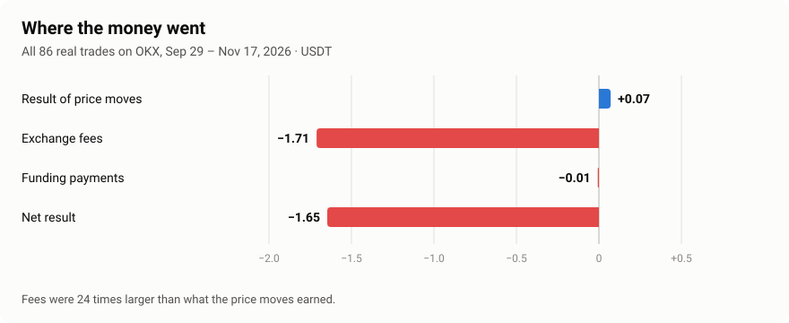

# Results

**We tried to build a profitable AI trading bot for crypto futures. It did not work.**

*Results as of 17 Nov 2026, when trading was wound down. Plain numbers, no hype. Not investment advice.*

This page is for retail traders and developers who are thinking about an AI or algorithmic bot for crypto futures. We spent seven weeks on exactly that, with real money and a strict research process, and found no edge. We publish everything so the next person can check our work in days instead of repeating it for months, and then decide with open eyes.

Related pages: [METHODOLOGY.md](METHODOLOGY.md) explains how strategies were tested, [AI_TEAM.md](AI_TEAM.md) how the AI team worked, and [QUICKSTART.md](QUICKSTART.md) how to run the tools yourself. Each main strategy and research line has a card in [strategies/](../strategies/) with its exact rules and results. Terms such as bps, round trip and stress are explained in the [glossary of METHODOLOGY.md](METHODOLOGY.md#12-glossary), and the two test gates in its sections on [gate K](METHODOLOGY.md#4-gate-k-the-historical-test) and [gate D](METHODOLOGY.md#6-gate-d-the-forward-test).

## Contents

1. [TL;DR](#tldr)
2. [What we built](#what-we-built)
3. [What we found](#what-we-found)
4. [Why it fails](#why-it-fails)
5. [What other research says](#what-other-research-says)
6. [What this does NOT prove](#what-this-does-not-prove)
7. [How the numbers were checked](#how-the-numbers-were-checked)
8. [How to try it yourself](#how-to-try-it-yourself)
9. [Коротко українською](#коротко-українською) (summary in Ukrainian)

## TL;DR

- **No edge found.** From 29 Sep to 17 Nov 2026 we ran AI-designed bots on OKX USDT perpetual futures (BTC, ETH, SOL). No strategy showed a proven profit after costs.
- **Real money: −1.65 USDT net on 86 round trips in 28 rounds.** Price moves earned +0.07 USDT gross. Fees took 1.71 USDT, 24 times more. The average trade gained about +0.4 basis points (bps; 1 bps = 0.01%) before costs and paid 10 bps in fees. Execution costs were as modelled or better. There was no edge to execute.
- **Research: 770+ configurations in about 20 days, one survivor, nothing proven.** One strategy ([H10-ETH](../strategies/sonnet-h10-eth/)) passed our historical test, barely. At the last evaluation it had 1 of the 30 trades on unseen data that its forward test needs. Ideas on horizons of hours to a day found nothing. Trend following over days and weeks looked great on history, mostly because crypto rose 15–51× in the selection window. On fresh data the best version lost money.
- **The AI part was cheap and added little.** The paid LLM decision API cost $0.19 in total. As a filter on numeric market data it added nothing measurable. The real cost was our time.
- **This matches research on retail traders.** 97% of Brazilian futures day traders who kept at it for 300+ days lost money. Fewer than 1% of Taiwanese day traders were predictably profitable after fees. It does not prove that nothing can ever work; see [What this does NOT prove](#what-this-does-not-prove).

## What we built

**A research team of AI agents.** From 28 Oct to 17 Nov 2026, Claude Code sessions (mostly Claude Opus 5.5) worked for one human owner, [kalambyrYura](https://github.com/kalambyrYura), and talked to each other through Markdown files in Git. The roles were fixed:
- a lead who sets the rules and logs every decision;
- a coordinator who integrates the code and reproduces candidates' results;
- a platform engineer for the trading engine, data, evaluator and releases;
- four strategy authors with made-up names (Astra, Sol, Sonnet, Opus). All four were Claude Opus 5.5 sessions, each worked on its own branch, and none was allowed to read the others' drafts;
- a fifth author slot, MYHuman, for the owner's own ideas, written up and tested by AI assistant sessions (one of those ideas is the paper-only [G1 triangle pattern](../strategies/myhuman-g1-ikigai-triangle/));
- a reviewer for every release and for every live round with a trade or a problem, an operator for the PC that runs live rounds, and a Judge who alone evaluates strategies on data held back from the authors.

Test series were pre-registered (hypothesis, configurations, selection rule); after the first candidate, the pre-registration had to be committed to Git before the first run. Every attempt, failures included, went into a trial log. [AI_TEAM.md](AI_TEAM.md) tells the full story, and [section 8 of METHODOLOGY.md](METHODOLOGY.md#8-rules-against-overfitting) lists the rules against overfitting.

An earlier phase (29 Sep – 27 Oct 2026) was run by OpenAI Codex with a team of about 28 GPT-based agents and chats, joined in early October by a Claude team on a second account (see [AI_TEAM.md](AI_TEAM.md)). That phase built the first one-trade bot, the web panel and the first rule-based bots, called "V1": [Astra V1](../strategies/astra-v1-controlled-impulse/), [Sol V1](../strategies/sol-v1-shallow-pullback/), [Opus V1](../strategies/opus-v1-capitulation-bounce/) and [Sonnet V1](../strategies/sonnet-v1-dump-buy/). Their recipes came from separate AI chats, two labelled as GPT models and two as Claude models (model names as declared, not verified).

**An evaluator with pass gates** ([tools/team_eval.py](../tools/team_eval.py)). It replays a JSON strategy recipe with the live trading rules: either the live engine itself, or a faster candle engine checked against it trade for trade. It runs on public OKX 1-minute history since 2020, for one 100 USDT account holding one position at a time. Costs are a 5 bps fee plus 2 bps slippage per fill, a modelled spread and real funding (a conservative charge where the funding history is missing). "Stress" adds 5 bps more per fill. The evaluator needs no network and no keys. The full rules are in [METHODOLOGY.md](METHODOLOGY.md).
- **Gate K (history, Jan 2020 – 2 Oct 2026):**
  - profit after costs, also under stress;
  - at least 100 trades;
  - no calendar year worse than −10% of capital;
  - at least 60% of active quarters profitable since 2024;
  - profitable in the last five quarters;
  - still at least break-even without its 10 best trades;
  - a pre-registration and a complete trial log.
- **Gate D (the Judge; data no author has seen, plus live rounds).** It counts the first N closed trades of a frozen recipe on that data (N ≥ 20, declared in advance):
  - profit after costs and under stress;
  - largest trade at most 30% of gross profit;
  - drawdown at most 10% of capital;
  - at least two 24-hour live rounds without execution problems, each with a fill of the strategy.
- **Timing test for long holds.** For strategies that hold for days or weeks, this test compares the real entry dates with the same trades shifted in time. It separates timing skill from plain market growth. The rule is in [section 5 of METHODOLOGY.md](METHODOLOGY.md#5-track-k-t-gate-k-for-long-holding-periods) and the tool is [team/judge/tools/gate_k_long.py](../team/judge/tools/gate_k_long.py). It was adopted on the last day for future research; no strategy was ever submitted under it.

**A live execution engine for OKX USDT perpetual swaps** ([trading_lab/](../trading_lab/)).
- **Accounts and keys.** It ran bots on BTC, ETH and SOL. In the arena rounds each bot had its own sub-account, usually with 100 USDT, on isolated margin at 1× (the final round used 3×). API keys had no withdrawal rights and were kept in local files that are not in Git.
- **Protection.** After every fill an exchange-hosted stop-loss is placed (target: within 5 seconds). Exits are reduce-only. Every fill, fee, funding payment and cash change is reconciled with the exchange. Anything unexplained pauses the bot for manual review instead of guessing.
- **Who presses the buttons.** AI agents never started a live round or sent an order. The owner pressed Start, Stop and Resume, and deterministic code placed the orders. A Telegram notifier sends alarms.
- **Optional LLM gate.** It is called Jev: a paid LLM decision API, model `typesafe/jev-1.13`, reached through OpenRouter. It can veto entries. Deterministic code owns risk and exits, and any LLM error means "no new entry". A persistent ledger caps spending.

**An arena viewer** ([web/](../web/), served locally by [web_panel.py](../web_panel.py)). It is a drawn "colosseum": bots enter the ring on real fills and leave when flat. It shows P&L after fees, a decision journal and replays. There are also league, review and strategy-workshop pages.

**What running it taught us.** A bot that runs around the clock is an operations job, not a script.
- Once the executor crashed, most likely because the disk was full. The paused round then sat for about 46 hours, although the alarm had arrived.
- Another time a stop-loss fired on the exchange but was not recognised as our own fill. The whole season paused for manual review.

Both incidents, and the defects that reviews caught before they reached real money, are described in [AI_TEAM.md](AI_TEAM.md).

## What we found

### Real money (29 Sep – 17 Nov 2026)

<picture>
  <source media="(prefers-color-scheme: dark)" srcset="img/money-dark.svg">
  
</picture>

| | USDT |
|---|---:|
| Rounds | 28 |
| Round trips (open + close) | 86 |
| Gross result of price moves | +0.071 |
| Trading fees | −1.711 |
| Funding payments | −0.007 |
| **Net** | **−1.647** |

- **Fees were 24 times the gross result.** The average position was about 20 USDT. The average trade gained about +0.4 bps before costs and paid 10 bps in fees (the 0.05% taker fee on each side).
- **Execution matched our model:**
  - median slippage about 0 bps (model: 2 bps);
  - fees exactly 10 bps per round trip;
  - exchange stops filled 2 bps better than their trigger.

  The loss is not a bug.
- **Three old bots did almost all the trading.** In the five mixed seasons (8–17 Nov), three early rule-based bots, [Sol V1](../strategies/sol-v1-shallow-pullback/), [Astra V1](../strategies/astra-v1-controlled-impulse/) and [Opus V1](../strategies/opus-v1-capitulation-bounce/), made 78 of the 79 round trips and paid 99.9% of the fees. On recent history each of them loses about 13.5–15 bps per trade after costs.
- **The best strategy never traded live.** [H10-ETH](../strategies/sonnet-h10-eth/), the only strategy that passed gate K, did not trade once in seven live rounds. Its trend filter (ETH above its 20-day average) was off most of the time: in the five rounds its author analysed, it was on in only 6% of the minutes, against 52% on history.
- **The small amounts are on purpose.** Each bot usually had 100 USDT, and the minimum BTC order was about 8.5 USDT. The percentages matter, not the dollars.

### Live rounds at a glance

| When | Rounds | What ran | Round trips |
|---|---:|---|---:|
| Late Sep – 28 Oct 2026, before the team | 18 | the one-trade bot, short order tests and the first arena rounds of the V1 bots | 6 |
| 30 Oct – 6 Nov 2026 | 5 | two 5-hour rounds of the four V1 bots, a 300-second order-path probe, and two 24-hour rounds of H10-ETH alone | 1 |
| 8–17 Nov 2026 | 5 | 24-hour "mixed seasons" of five bots: the three V1 bots on BTC, H10-ETH on ETH, and the MYHuman slot's hybrid (the [ETH version](../strategies/myhuman-hybrid-eth-rbcd/), from the third season the [SOL version](../strategies/myhuman-hybrid-sol-b/)) | 79 |
| **Total** | **28** | | **86** |

**Not included:** the final round, a 24-hour season of the same five bots at 3× leverage, which started on 17 Nov 2026 and ran into 18 Nov 2026. It was still running when these totals were compiled, so none of its trades, fees or funding are in any number on this page.

### The research funnel

| Stage | What was tested | Result |
|---|---|---|
| Early screen (Oct 2026, on Jul–Sep 2026 data) | 16 rule sets × 59 one-day windows (944 runs) | 13 of 16 lost money after costs; 12 of 16 lost even before fees |
| Earlier minute-level search | about 4,700 parameter combinations | nothing usable |
| Team phase (28 Oct – 17 Nov 2026) | 770+ configurations by 5 authors, with pre-registration and a log of every attempt | 1 passed gate K ([H10-ETH](../strategies/sonnet-h10-eth/)) |
| Gate D on unseen data (the Judge) | H10-ETH needs 30 trades | 1 of 30 at the last evaluation (data up to 30 Oct 2026): not enough to judge |
| Cycle 1: hours to a day | 48 configurations, 4 authors | no candidate |
| Cycle 2: days to weeks, trend following | 54 configurations, 2 authors | no candidate |

All 16 strategy cards, with their status, are listed in the [README](../README.md#the-strategies).

**[H10-ETH](../strategies/sonnet-h10-eth/), the one survivor.**
- **Rules:** ETH long only. After a sharp one-hour rise while the price is above its 20-day average, it places a passive limit buy a little below the price. It holds up to 24 hours, with a −5% stop and a +10% target. Each trade uses about 11 USDT, and it trades about 0.2 times a day.
- **History, 2020–2026:** 550 trades, +30.81 USDT net, +25.33 under stress.
- **Since 2024:** +6.68 USDT, about 2.4% a year on the 100 USDT allocated. 7 of 11 quarters were positive (64%), just above the 60% threshold.
- **Last five quarters:** +6.03 USDT on 93 trades.
- **Unseen data:** 1 of its 30 trades at the last evaluation, and that trade lost 0.08 USDT. At its backtest pace the 30th trade was expected about 148 days after 2 Oct 2026, around the end of February 2027. After a quiet first month the author's estimate moved to March–April 2027.
- **Weak proof even at 30 trades:** the same trade pattern with zero edge passes the 30-trade test about 43% of the time. Bigger positions would scale the drawdowns and the uncertainty too.

**Cycle 1: hours to a day.** Typical moves per trade were 85–520 bps, several times the costs, so fees were not the main problem here. Still nothing passed:
- A US-session reversal idea lost money in all 8 configurations ([Astra's research lines](../strategies/astra-research-summary/)).
- Shorting after sharp drops passed 0 of 8 ([Sonnet's short on continued decline](../strategies/sonnet-nc1-short-continuation/)).
- Buying after deep sell-offs depended on its 10 best trades: all 16 selectable configurations, which bought only in a falling market (price not above its 20-day average), failed that check. Their control twin without that filter, the most informative variant, passed it but failed gate K on its recent years and on its worst year, 2022 ([Opus's capitulation card](../strategies/opus-nc1-sol-k3-tk-t400-noreg/)).
- The closest was a SOL entry just under the 7-day high, bought with a limit order on a small pullback ([Sol's maker pullback](../strategies/sol-nc1-maker-pullback/)). It made +20.0 USDT over 2021–2026 (+10.1 under stress). Without its 10 best trades it was −10.3 USDT, and it was profitable in only 6 of 11 recent quarters.
- A SOL recipe combining two of these ideas ([the MYHuman synthesis](../strategies/myhuman-nc1-synthesis/)) also failed that quarter test. It went to the forward test labelled "not proven" and had 0 of its 30 trades when the project stopped. In the last five quarters it made only +4.3 bps per trade, and it was negative under stress.

**Cycle 2: days to weeks.** The official evaluator cannot hold a position longer than 24 hours, so most of these numbers come from the authors' own engines with the evaluator's cost model. They are indicative.
- **[Weekly momentum](../strategies/sonnet-nc2-weekly-momentum/) on BTC, ETH and SOL (30 configurations).** On BTC and ETH it had about half the drawdown of simply holding. Its risk-adjusted return was no better, and it was weak since 2024. None passed.
- **[Channel breakout with a trailing stop](../strategies/sol-nc2-channel-breakout/) (24 configurations).** All 24 were profitable on the selection period. The winner made +95.5 USDT on 55 SOL trades over 2021–2026. On the fresh tail (Jul 2025 – Oct 2026) it lost 0.79 USDT on 11 trades.

## Why it fails

1. **Short horizons: the fee is bigger than the move.** Our fast live bots (V1) gained on average +0.6 bps per trade before costs over 72 live trades (8–17 Nov 2026), against 10 bps of fees per round trip. With modelled slippage the cost is 14 bps. Also, 12 of 16 early rule sets lost money even before fees, so cheaper fees alone would not have saved them.
2. **Hours to a day: big enough moves, no direction.** Moves were hundreds of bps per trade, yet results were still negative or hung on a few lucky trades. Cheaper limit-order entries made it worse. The limit orders that never filled would have been the best trades (+82 to +227 bps). The ones that filled lost (−8 to −78 bps). Details are in [Sol's maker pullback card](../strategies/sol-nc1-maker-pullback/).
3. **Days to weeks: the profit is the market, not the strategy** ([channel breakout card](../strategies/sol-nc2-channel-breakout/)).
   - Over the selection window, buy-and-hold made BTC ×14.9, ETH ×19.2 and SOL ×51.
   - Random long entries with the same holding times earned 462 bps per trade before costs over 2021–2026. The winner's actual entries earned 622, and 31% of random draws did at least as well.
   - A synthetic strategy that buys on random days and holds for weeks shows a profit, even under stress, in 88–98% of runs on this history.
   - On the fresh tail, when SOL fell 23%, the winner lost money. Its trailing stop limited the damage, which is protection, not profit.
   - Adding short trades did not help in any of our studies and usually made results worse.
4. **Proving an edge honestly takes months, and the proof stays weak.** See H10-ETH above. With about 6.75 years of history and a few trades a year, a weak edge cannot be told apart from luck.
5. **The LLM did not add information** ([Jev research card](../strategies/opus-jev-j0-j2/)).
   - On anonymised numeric features it gave nearly the same answer to any input. It said "abnormal" 149 times out of 150, and "lower" about 80% of the time even on mirrored data.
   - Its confidence reflected how many conditions the prompt listed, not the market.
   - This is a result for our prompts and data, not a verdict on the model in general. A test on news text had only started.
   - Total LLM spend was $0.19. Live rounds since 30 Oct ran rules-only and used $0.

## What other research says

- **Brazil:** of people who day-traded mini-index futures for more than 300 days, 97% lost money (Chague, De-Losso & Giovannetti, "Day Trading for a Living?", FGV EESP working paper TD 525, 2020; also on SSRN).
- **Taiwan, 1992–2006:** fewer than 1% of day traders were predictably profitable net of fees (Barber, Lee, Liu & Odean, "The cross-section of speculator skill: Evidence from day trading", Journal of Financial Markets, 2014).
- **European Union, 2018:** 74–89% of retail CFD accounts lose money (ESMA, press release of 27 March 2018).
- **Fees:** OKX regular-tier futures fees are 0.02% for maker orders and 0.05% for taker orders (OKX fee schedule). A trade in and out with market orders starts 0.10% (10 bps) behind, before slippage.

## What this does NOT prove

- **Our setup:** OKX USDT-margined perpetual swaps on BTC, ETH and SOL; the regular fee tier; mostly market orders; tiny accounts (usually 100 USDT per bot, about 20 USDT average position); isolated margin at 1×.
- **Our period:** history from 2020 to Oct 2026, and live trading for seven weeks (29 Sep – 17 Nov 2026). Other periods and instruments can behave differently.
- **Our strategy space:** rule-based recipes on 1-minute candles, funding and some higher-timeframe features, written by AI agents and one human. We did not test:
  - market making with fee rebates;
  - latency-sensitive trading;
  - cross-exchange or funding-rate arbitrage;
  - order-book or on-chain data;
  - portfolio approaches.

  LLM reading of news had only started.
- **Our model:** backtests use 1-minute candles with reconstructed 5-second quotes. They cannot model queue position, latency or partial fills, so results for limit orders are uncertain.
- **Our gates** are strict on purpose. Looser gates would pass more strategies, and more luck.
- **The live sample is small** (86 round trips). The size of the loss says little. The per-trade arithmetic and the research results say more.
- **It is not** a claim that all trading loses, that nobody makes money, or that AI can never help. It is one documented attempt that found nothing, with the tools to check it. It is not investment advice.

## How the numbers were checked

- **Every number has a source.** Before publication each number on this page was traced to the file it came from: an evaluator output, a round review, a trial log or a decision record. Most of those working files were internal and are not part of this repository. The public files that carry the same numbers are listed below.
- **Real money was re-derived.** Independent agents recomputed the totals from the round packets (the evidence archive exported after each round, with the exchange's fills, fees, funding payments and cash changes) and from the run journals of the earliest tests. Gross plus fees plus funding equals net in every round, and the net of each mixed season matches its round review.
- **Backtests were reproduced.** For H10-ETH, the author's official run, the platform's run and the coordinator's reproduction gave the same trade list byte for byte. The Judge re-ran its forward sample after every later code change and got the same trades. Numbers marked "indicative" come from an author's own engine, not from the official evaluator.
- **External citations were checked against their sources.** The Taiwan figure was checked against the paper's full text, the Brazil figure against the paper's published abstract, and the EU figure against ESMA's press release. Fee schedules change, so check OKX's current fee page; our own fills paid exactly 0.05% per taker fill, and 0.02% on the maker fill of the order-path probe.
- **Two totals were not recounted line by line.** "770+ configurations" is the sum of the authors' own counters, because their trial logs used different formats. The LLM total ($0.19) is the sum of the reported costs in the project's paid-call ledgers, which are local files and are not published.

| To check | Look in |
|---|---|
| Gates, data periods, cost model, calibration and final verdicts | [METHODOLOGY.md](METHODOLOGY.md) |
| Each strategy's rules, backtests, live rounds and how to reproduce them | [strategies/](../strategies/) |
| The evaluator | [tools/team_eval.py](../tools/team_eval.py) and [tools/team_eval_v4.py](../tools/team_eval_v4.py) |
| The timing test for long holds, and the gate D count of the first N trades | [team/judge/tools/gate_k_long.py](../team/judge/tools/gate_k_long.py) and [team/judge/tools/gate_d_first_n.py](../team/judge/tools/gate_d_first_n.py) |
| The recipe format | [RECIPE_SPEC.md](RECIPE_SPEC.md) |
| Roles, rules and incidents of the AI team | [AI_TEAM.md](AI_TEAM.md) |

## How to try it yourself

1. **Read before you code.** Start with this page. Then read [METHODOLOGY.md](METHODOLOGY.md) (the gates, the data split and the rules against overfitting), [AI_TEAM.md](AI_TEAM.md) (how the team worked and what went wrong) and the [strategy cards](../strategies/). Each card gives the exact rules, the results, why they are not enough and what to try next.
2. **Set up.** You need Python 3.12 and the packages in [requirements.txt](../requirements.txt) (numpy, for the evaluator). The panel itself uses only the standard library. [QUICKSTART.md](QUICKSTART.md) has the details. Steps 3–6 need no API keys and no money. The commands below use the Windows launcher `py -3.12`; on macOS or Linux use `python3.12`.
3. **Get free data.**
   - `tools/public_history.py fetch` downloads OKX 1-minute candles and funding from public endpoints (GET requests only).
   - `tools/team_data.py catalog` and `verify` build and check the data store that the evaluator reads.
   - Expect several hundred MB per instrument: our full-history stores took about 380 MB for BTC, 750 MB for ETH and 577 MB for SOL.
   - OKX's public funding endpoint reaches back only about three months. Without OKX's monthly funding archive, the evaluator charges a conservative estimate for missing funding, so your numbers can differ slightly from ours.
   - By default the evaluator looks for `data/okx/<instrument>` under the folder you run it from; pass `--store` to use another folder.
4. **Reproduce one number.** Run `py -3.12 -X utf8 -B tools/team_eval.py run --recipe strategies/sonnet-h10-eth/recipe.json --store <your ETH-USDT-SWAP store> --set dev --out <folder>`. Then compare `gates.md` with the H10-ETH numbers above (550 trades, +30.81 USDT net, +25.33 under stress). Without `--prereg` and `--trials` the overall verdict reads NOT_ALL_CHECKS_EVALUATED, because the paperwork check is skipped. The run takes about 2–3 minutes in one process and needs 3 GB of free memory; on a laptop, run one heavy job at a time.
5. **Test your own idea the same way.**
   - Write a JSON recipe ([RECIPE_SPEC.md](RECIPE_SPEC.md)).
   - Write down the hypothesis and every configuration before the run.
   - Keep a log of all attempts and use the same gates.
   - For long holds, add a random-entry control and the timing test ([team/judge/tools/gate_k_long.py](../team/judge/tools/gate_k_long.py)).
   - If you read this months later, the data after November 2026 is a clean test for every frozen recipe here.
6. **See the arena with fake data.** Run `py -3.12 -X utf8 -B tools/preview_arena.py --coliseum-proof 6`. It uses a synthetic market, a fake exchange and temporary folders, and serves the arena at `http://127.0.0.1:8766/arena`.
7. **Only then, if you still want to:**
   - OKX demo trading with a demo key;
   - then a small live sub-account;
   - an API key without withdrawal rights;
   - money you are ready to lose;
   - "do nothing" (cash) as the benchmark;
   - a stop rule written down before the first trade.

## Коротко українською

Сім тижнів (29.09–17.11.2026) ми будували й запускали ботів, придуманих ШІ, на безстрокових ф'ючерсах OKX (BTC, ETH, SOL) — з реальними грошима й суворою перевіркою.
Реальні гроші: 28 раундів, 86 угод; рух ціни дав +0,07 USDT, комісії забрали 1,71 USDT (у 24 рази більше), фандинг −0,007 USDT; разом −1,65 USDT.
Останній раунд із плечем 3× (17–18.11.2026) у ці підсумки не входить.
Виконання на біржі відповідало моделі; проблема в тому, що переваги немає: у середньому +0,4 bps руху на угоду проти 10 bps комісії за вхід і вихід.
За ≈ 20 днів п'ять авторів перевірили понад 770 конфігурацій; історичні ворота пройшла одна стратегія (H10-ETH), а на нових даних вона встигла зробити лише 1 угоду з потрібних 30.
На горизонті від годин до доби переваги не знайшли; тренд на днях і тижнях заробляв здебільшого на рості ринку (BTC ×14,9, ETH ×19,2, SOL ×51), а на свіжих даних найкращий варіант у мінусі.
Платний ШІ-фільтр коштував усього $0,19 і на числових даних нічого не додав.
Це збігається з дослідженнями роздрібних трейдерів: у Бразилії 97 % тих, хто торгував ф'ючерсами всередині дня понад 300 днів, втратили гроші; на Тайвані передбачувано прибуткових після комісій — менше 1 % денних трейдерів.
Ми викладаємо все, щоб наступний охочий перевірив це за кілька днів, а не витратив місяці; це не доказ, що заробити неможливо в принципі, і не фінансова порада.
